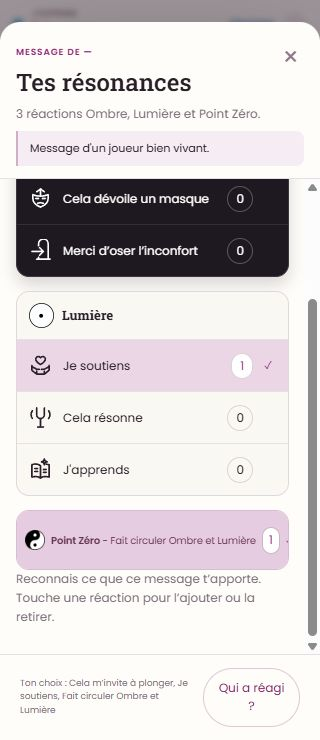

# Messagerie — recette navigateur en préproduction

> Note Codex — 22 octobre 2026. Demandée par Boris pendant sa propre recette.
> Compte fourni : état M1 accompli. Aucun identifiant ni mot de passe dans cette note.
> Vérification de l’interface réellement servie, pas du seul dépôt ou prototype.

## Périmètre effectivement parcouru

Connexion normale, puis `/echanges` →
`https://preprod.167-233-210-57.sslip.io/espaces/1827?lu=1`, l’espace du Monde 1
accessible au compte. Vérifications à 390 × 844, 320 × 740 et 1440 × 1000 CSS px
dans le navigateur intégré. Ces dimensions ne remplacent pas une recette sur
un téléphone physique et avec son clavier logiciel. Viewport rétabli en fin de passe.

Aucun message publié, modifié ou supprimé ; aucune réaction ajoutée/retirée,
aucun sondage voté/publié, aucune préférence de notification changée, aucun
regard sollicité. Connexion et ouvertures/lectures normales seulement ; les
marqueurs de lecture éventuels restent ceux des comportements normaux du site.

## Résultats observés

| Contrôle | Observation |
| --- | --- |
| Connexion compte M1 | Réussie, identité de recette et accès M1 cohérents. |
| Fil mobile 390 px et ordinateur 1440 px | `scrollWidth` du document égal au viewport ; pieds compacts à l’intérieur des cartes, compteurs à gauche et heure/état à droite. |
| Résonances | Sept choix exacts, Ombre noir/blanc, Lumière claire et ligne Point Zéro. Le total 3 d’un message correspond à trois choix existants affichés à 1. Aucune bascule faite. |
| Smileys | Six choix directs et douze dans « Un autre smiley », soit dix-huit ; total 2 cohérent avec deux poses existantes. « Qui a réagi ? » ouvre le détail. |
| Options personnelles | Modifier et Supprimer accessibles sur le message et sur la réponse. Pas de Mémoire dans ce canal de Monde : cohérent avec le périmètre V1 groupes/cercles. Aucune commande exécutée. Les trois interactions sont encore absentes du menu : à aligner sur la précision de Boris ci-dessous. |
| Modification | Formulaire prérempli avec le texte du message ; fermeture sans enregistrer. |
| Échap/focus | Ferme la fenêtre et rend le focus au bouton Options du message. |
| Discussion liée | Message racine rappelé, une réponse affichée sur une ; pied et options propres à la réponse. |
| Répondre à une réponse | Le composeur reçoit « Répondre à Accompli… ». Aucun envoi ; vérification de ciblage UI, pas validation de persistance. |
| Sondages | « Afficher : Sondages · 1 » retrouve l’objet existant ; retour à Fil fonctionnel. |
| Recherche | « test » retourne quatre messages existants, avec extraits et liens vers le fil. |
| Menu supérieur | Infos du groupe, Notifications, Aide, Export ; aucune commande étrangère aux droits observés. |
| Membres | Infos du groupe ouvre la liste de onze participants, cohérente avec le nombre du bandeau. |
| Composeur + | Sondage, rencontre, action et ressource proposés dans ce contexte. Création de sondage dans une fenêtre unique, champs/options accessibles ; fermeture sans publication. Les autres fonctions sont à vérifier dans leurs contextes autorisés. |
| Console | Aucune entrée erreur/avertissement remontée pour cet onglet pendant cette passe. |

> Mise au point du 23 octobre : #468 précise les trois interactions dans les
> menus **d’autrui**, avec gestion personnelle inchangée. L’absence de ces
> interactions dans les menus personnels observés ci-dessus n’est donc pas un
> défaut à corriger. Voir la note de spécification actualisée.

## Précision de Boris reçue pendant la recette

Boris veut conserver **Smiley / Réagir / Répondre dans les « … »**, en plus du
pied compact et des opérations de gestion selon les droits. Il indique avoir
prévenu Claude. Les menus de cette passe ne sont donc pas validés comme cible
finale ; voir [la note de correction des spécifications](../vision/messagerie-menu-messages-interactions-2026-10-22.md).

## Défaut visuel reproductible : coche Point Zéro à 320 px

**Faible priorité, à corriger dans le portage.** À 320 × 740, ouvrir le compteur
Source du message `33504` (trois résonances existantes), puis faire défiler la
fenêtre vers Point Zéro. Le choix est déjà sélectionné sur ce compte.

La ligne fait 271 px utiles mais son `scrollWidth` atteint 277 px. La coche à
droite est rognée. Le document et la fenêtre n’ont pas de débordement horizontal
global : ce défaut local serait manqué par le seul contrôle du `body`.

Préserver le libellé sur une ligne, le compteur et le repère sélectionné ;
réserver leur place et resserrer les espaces internes si nécessaire à cette
largeur. Éviter de résoudre le défaut en réduisant encore le texte, déjà à 10 px
sur cette ligne. Refaire sélectionné/non sélectionné à 320 et 390 px.

## Limites de cette passe

- Les trois contre-exemples de la [relecture précédente](../vision/messagerie-relecture-portage-strict-et-mentor-2026-10-23.md)
  (document masqué, longue réponse, attente asynchrone étrangère à une édition)
  ne sont pas déclarés corrigés par cette recette visuelle. Pas de scénario
  d’écriture ou de grands volumes créé pour les rejouer sur ce compte.
- Pas de validation des mutations, persistance, concurrence à deux comptes,
  accord IA, Mémoire versionnée, suppression, invitations, notifications,
  envoi de fichiers ni des droits hors de cet espace.
- Pas de recette clavier mobile, lecteur d’écran ou téléphone physique.
- Le fil de préprod contient beaucoup de messages de bancs et d’auteurs « — » :
  ne pas confondre cette matière de test avec un problème d’identification
  reproduit sur des comptes réels de production. Aucun nettoyage effectué.

Cette passe confirme les interfaces et navigations listées, pas une recette
fonctionnelle exhaustive de la messagerie.
